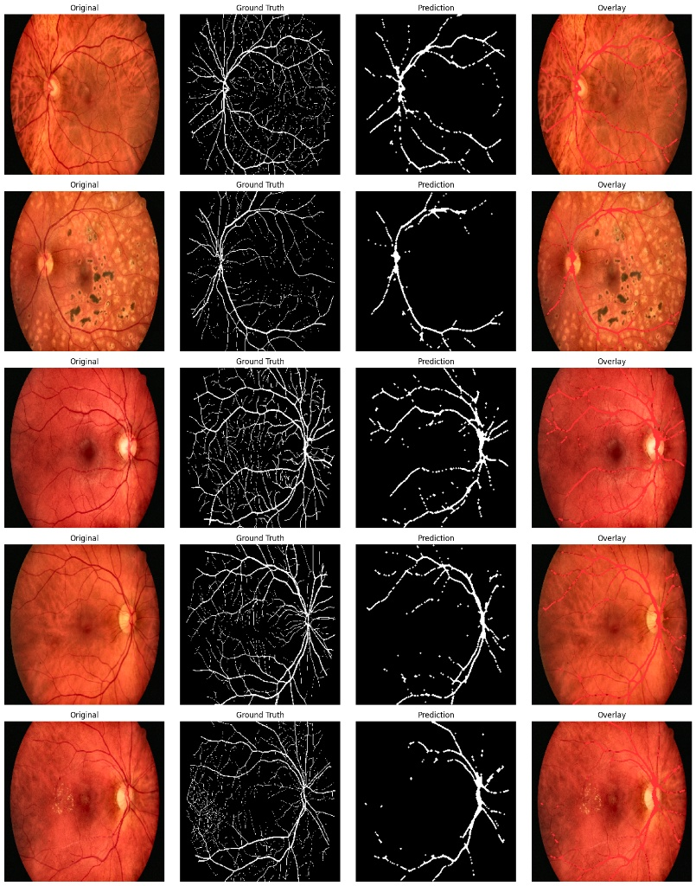

# Retinal blood vessel segmentation: five architectures on 45 fundus images

A PyTorch notebook that trains five segmentation networks (U-Net, Attention
U-Net, Residual U-Net, U-Net++ and FPN) to trace blood vessels in retinal fundus
photographs, compares four loss functions, and visualises the predictions.

This is a coursework experiment run on a laptop CPU. It is not a clinical tool
and its accuracy is well below what published models reach on this task; the
reasons are listed under [Why the scores are low](#why-the-scores-are-low).



The models find the main vessels and miss most of the fine ones, as the grid shows.

## Data

45 fundus images with hand-drawn vessel masks and field-of-view masks, in the
folders `all/images`, `all/manual1` and `all/mask` (15 cases × 3 groups; this
layout matches the public HRF dataset). The images are not in this repository.

- Split: 36 for training, 9 for validation (seed 42). There is no separate test set.
- Vessels are 7.95% of the pixels, so the classes are heavily imbalanced.
- Preprocessing: CLAHE contrast enhancement, resize to 256×256, ImageNet normalisation.
- Augmentation: flips, rotations, colour jitter, elastic transform, Gaussian noise.

## Results recorded in the notebook

Loss comparison on U-Net, 10 epochs each (best validation Dice):

| Loss | Dice |
|---|---:|
| BCE + Dice | **0.461** |
| Tversky | 0.417 |
| Weighted BCE | 0.388 |
| Focal | 0.231 |

All five models trained with BCE + Dice for up to 50 epochs with early stopping,
scored per image on the 9 validation images (mean ± standard deviation):

| Model | Dice | IoU | Precision | Recall |
|---|---:|---:|---:|---:|
| U-Net++ | **0.570 ± 0.047** | 0.400 | 0.528 | 0.622 |
| Attention U-Net | 0.562 ± 0.041 | 0.392 | 0.570 | 0.557 |
| Residual U-Net | 0.560 ± 0.038 | 0.390 | 0.602 | 0.525 |
| U-Net | 0.550 ± 0.037 | 0.380 | 0.507 | 0.604 |
| FPN | 0.549 ± 0.035 | 0.379 | 0.562 | 0.538 |

The five models are within one standard deviation of each other, so on this
data the architecture made no measurable difference. (The notebook's training
summary ranks them by best-epoch Dice instead, where Attention U-Net leads at
0.564; the table above is the per-image evaluation.)

The final section averages the two best models with test-time augmentation and
morphological clean-up to draw the prediction grid. The notebook does not print
a score for that ensemble.

## Why the scores are low

Published U-Net variants reach a Dice of roughly 0.8 on standard retinal vessel
benchmarks. This run reaches 0.55 to 0.57, most likely because:

1. **Resolution.** The images are shrunk to 256×256. Fine vessels are one or
   two pixels wide at full size and disappear when downsampled, and the masks
   are resized with nearest-neighbour, which breaks thin vessels.
2. **Very little data.** 36 training images, trained from scratch.
3. **CPU-only training**, which is why the image size and batch size (4) were kept small.
4. **No field-of-view masking.** The FOV masks are loaded but the metrics are
   computed over the whole image.
5. **No held-out test set.** The 9 validation images are also used for early
   stopping and for picking the best model, so even these numbers are slightly optimistic.

The most useful next step is patch-based training at full resolution
(for example 512×512 crops), which removes the first cause.

## Run it

```bash
pip install -r requirements.txt
jupyter notebook retinal_segmentation.ipynb
```

Place the dataset so that `all/images`, `all/manual1` and `all/mask` sit beside
the notebook. A GPU is used automatically if PyTorch can see one.

## Files

| File | |
|---|---|
| `retinal_segmentation.ipynb` | the experiment with its saved outputs |
| `output.jpeg` | prediction grid from the recorded run |
| `requirements.txt` | packages the notebook imports |
